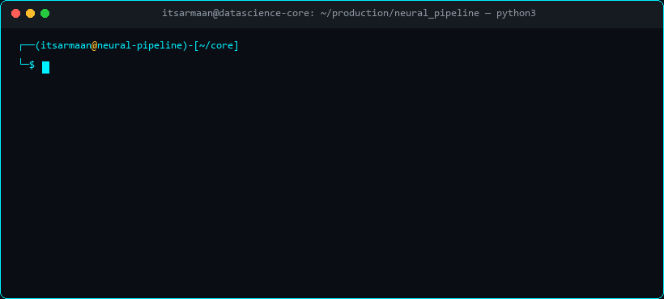

<!-- Hero Name Typing Header (Responsive) -->

<!-- Subtitle Loop (Responsive) -->

  

<!-- Cinematic Cyber / Lofi Data Stream Banner (Responsive) -->

  

 

**Neural operations strictly optimized. Welcome to my GitHub workspace.**

I am a Computer Science undergraduate specializing in **Data Science, Predictive Modeling, and Machine Learning Architecture**. Obsessed with transforming high-dimensional data noise into actionable intelligence. From exploratory statistical analysis and feature pipelines to production-grade institutional platforms, my algorithms are engineered for real-world impact.

 

<!-- Active Directives Table -->

<table width="100%" style="max-width: 820px;">
  <tr>
    <td width="50%">🔭 <b>Current Objective:</b> Scaling <a href="https://github.com/Armaan385/DocuMind"><b>DocuMind</b></a> GenAI RAG engine</td>
    <td width="50%">🧠 <b>Deep Research:</b> Vector cosine retrieval &amp; zero-hallucination pipelines</td>
  </tr>
  <tr>
    <td width="50%">⚡ <b>Core Engine:</b> Python 3.13, PyTorch, Scikit-Learn, Gemini 2.5</td>
    <td width="50%">📫 <b>Direct Transmission:</b> <a href="mailto:armaan11chaudhary@gmail.com">armaan11chaudhary@gmail.com</a></td>
  </tr>
</table>

 

  
   
  
  

 

<!-- CORE COMPETENCIES & TECHNICAL ARSENAL -->

  

<!-- Full-Fidelity Animated Dev Icons (Mobile Responsive) -->

  

  <b>LANGUAGES &amp; RUNTIMES</b> 
  
  
  
  
    
  <b>DATA SCIENCE &amp; MACHINE LEARNING</b> 
  
  
  
  
  
    
  <b>DATABASES, PLATFORMS &amp; SYSTEMS</b> 
  
  
  
  
  

<!-- Holographic Data Science Command Center (Cinematic Video Loop) -->

  

 

<!-- DATA EXTRACTION & INFERENCE PIPELINE (LIVE TERMINAL SCREEN) -->

  

<!-- Live Interactive Neural Pipeline Terminal (Animated Typing Loop) -->

  

 

<!-- TELEMETRY & GITHUB METRICS SECTION (PHONE FRIENDLY) -->

  

  

  

  

  

 

<!-- DEPLOYED OPERATIONS SECTION -->

  

<!-- Flagship Repository Showcase Cards (Tokyo Night Cyberpunk Grid) -->

  
  

 

<!-- Operation 01: DocuMind AI -->

  
   
  
  
  
  
  
  

  <b>Autonomous Retrieval-Augmented Generation (RAG) platform that indexes scientific PDFs, research papers, and technical documents with sub-second vector cosine retrieval, strict grounding, and page-level citations.</b>

 

<!-- Operation 02: Apex Academy Live Animated Manifest -->

  

  
   
  
  
  
  
  

  <b>Enterprise academic management ecosystem featuring role-based portals, biometric attendance simulation, automated QR invoice generation, fee schedule tracking, and WhatsApp communication hooks.</b>

 

<!-- TRANSMISSION LINKS -->

  

  
  
  
  
  

 

<!-- VISITOR METRICS FOOTER -->

  
    
  

